  

# 👋 Olá, eu sou o Otavio Fertig

💻 Desenvolvedor com formação em andamento, com o objetivo de me tornar fullstack e trabalhar com integração entre aplicações e banco de dados.

## 🚀 Tecnologias que utilizo

  
  
  
  
  
  
  
  
  
  
  

## 📚 Atualmente estudando

- Node.js
- Desenvolvimento Web Completo
- Integração Front-end + Back-end

## ⭐ Projeto em destaque

**[Gerenciador de Tarefas](https://github.com/Otaviofertig/dsw-gerenciador-tarefas)**: sistema multiusuário com login, feito na disciplina de Desenvolvimento de Sistemas Web. Tem API em Node.js + Express + TypeScript, tela em React + Tailwind, banco na nuvem (Turso) e está publicado no Render.

 

## 📫 Contato

 
